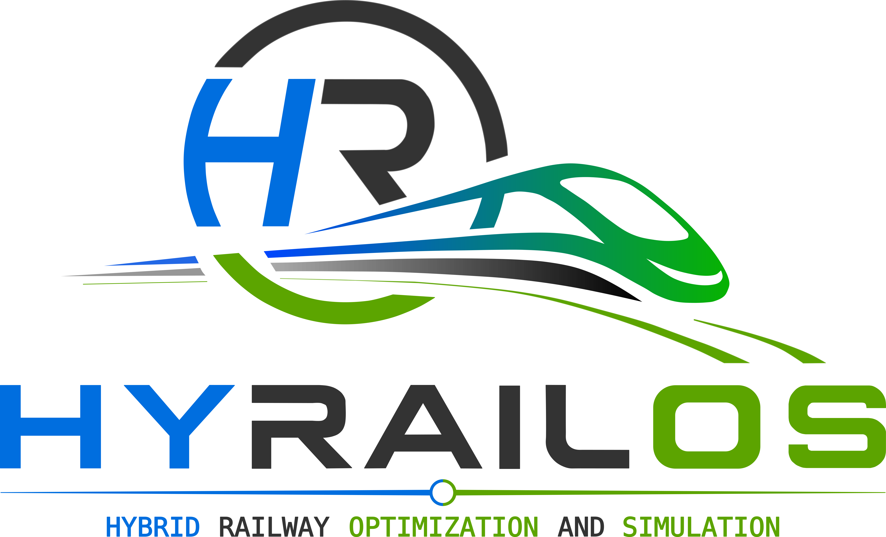

# HYRAILOS



HYRAILOS (Hybrid Railway Optimization and Simulation) is an open-source library for modeling, simulation, and energy management of hybrid railway systems. It allows users to configure different train architectures by selecting the number and type of carriages, onboard energy sources, electrical parameters, route profiles, and operating scenarios. The library combines a microscopic train model developed in Modelica with a Python control-oriented layer through a functional mock-up unit (FMU). This enables closed-loop testing of advanced control strategies, such as model predictive control (MPC), on a high-fidelity train model.

## Main Features

HYRAILOS can be used to:

- simulate hybrid trains over selected routes and operating time windows
- configure the train structure by selecting the number and type of carriages
- compare different energy management strategies, including low-pass filter frequency splitting (LPF-EMS), dynamic programming (DP), and MPC
- include onboard energy sources such as hydrogen fuel cells, lithium-ion batteries, and supercapacitors
- model different train components: traction motors, auxiliary services, overhead catenary supply, inter-carriage connections, and power converters
- define catenary availability along the route
- tune MPC sampling time, prediction horizon, and cost-function weights
- compute and compare quantities such as currents, voltages, states of charge, energy losses, and computational time

## Repository Structure

The repository contains two main parts:

- `Modelica`: detailed physical train models written in Modelica
- `Python`: Python optimization and simulation

## Requirements

The current local environment is tested with:

```text
Python 3.14.2
```

The main required packages are:

- `idaes-pse`
- `fmpy`

The MPC optimization uses IPOPT through Pyomo/IDAES. After installing `idaes-pse`, install the IDAES solver extensions with:

```powershell
idaes get-extensions --extra petsc
```

The Modelica package uses:

```text
Modelica Standard Library 4.0.0
```

OpenModelica can be used to open the package, check the models, and export FMUs.

### Python environment and VS Code

Clone the repository and open its root in VS Code:

```text
git clone https://github.com/ManuelCamarda/HYRAILOS.git
cd HYRAILOS
```

While the repository is private, cloning requires access granted by the owner.

For a new clone, create a local `.venv`
using **Python: Create Environment**, or from a terminal at the repository root:

```text
python -m venv .venv
```

If you already have a working environment, select it instead of recreating it.
Select it with **Python: Select Interpreter**, then open a new VS Code terminal
and install the dependencies:

```text
python -m pip install -r Python/requirements.txt
```

Install the IPOPT solver extensions as described above. FMUs are provided for both Windows and Linux. Linux users should select `FourCarriagesFMU_Linux.fmu` by updating the `fmu_path` in `User_Settings.py` (see the Linux Users section below).
Plotting uses external LaTeX (`text.usetex=True`), which must also be installed.

## Quick Start

First-time users should start from:

```text
Python/Case_Study_Simulation/User_Settings.py
```

The typical workflow is:

1. Modify the `settings` dictionary in `User_Settings.py`. For a first test, the default settings can be left unchanged to run the available case study 
2. Run `User_Settings.py`
3. The Python code automatically loads the FMU generated from the Modelica train model
4. The simulation compares the LPF-EMS, DP, and MPC strategies
5. Results are plotted and summarized in a table

From an activated environment at the repository root, run:

```text
python Python/Case_Study_Simulation/User_Settings.py
```

Relative traction-profile and FMU paths are resolved from
`Python/Case_Study_Simulation`, independently of the terminal working directory.
Generated PDFs are overwritten in `Python/Case_Study_Simulation/Results/Figures`.

To run the Python checks and both bundled FMU integration checks on Windows:

```text
cd Python/Case_Study_Simulation
python -m unittest discover -s tests -p "test_*.py"
python tests/validate_fuel_cell_fmu.py
```

## User Settings

This is the main file:

```text
Python/Case_Study_Simulation/User_Settings.py
```

The main editable parameters are:

- `traction_current_path`: path to the `.mat` file containing the traction current reference along the considered route. The expected format is 2 columns without header: time in seconds and current in amperes
- `car_types`: train structure. Use `"t"` for traction carriages (containing all components) and `"a"` for auxiliary carriages (containing only auxiliary services)
- `data`: carriage data functions. The order must match `car_types`
- `cat_pos`: specify which carriage is connected to the catenary. Use `0` for no catenary connection
- `catenary_intervals`: time intervals, in minutes, where the catenary is available along the considered route
- `fmu_path`: FMU file used as the plant model
- `converter_efficiency`: constant averaged efficiency applied to every onboard fuel-cell, battery, and supercapacitor DC/DC converter; use `1.0` to assume an ideal, lossless converter model
- `t_start`, `t_end`: simulation start and end times, in minutes 
- `tau_s`: FMU integration step, in seconds
- `tau_s_MPC`: MPC sampling time, in seconds
- `N`: MPC prediction horizon
- `wfc`, `wb`, `wsc`, `wcat`: MPC and DP cost-function weights
- `solver`: Pyomo solver. The current setup uses IPOPT
- `plot_results`: if `True`, plots and the summary table are shown

Carriage parameters are defined in:

```text
Python/Case_Study_Simulation/data_carriage.py
```

This file contains numerical parameters for each carriage, including resistances, inductances, capacitances, voltage limits, threshold values, and initial states of charge. Modified values must remain physically consistent with the train model and route profile; otherwise, the simulation may fail due to numerical issues or infeasible operating conditions. Changing the physical train structure may also require generating a new FMU from Modelica.

## Linux Users: Using the FMU

The default case study uses the already available FMU:

```text
Python/Case_Study_Simulation/FourCarriagesFMU.fmu
```

This FMU was generated on Windows. Since FMUs contain platform-specific binaries, Linux users should instead use the already provided:

```text
Python/Case_Study_Simulation/FourCarriagesFMU_Linux.fmu
```

Simply update `fmu_path` in `User_Settings.py`.

## Modelica Package

The root Modelica package is:

```text
Modelica/HYRAILOS/package.mo
```

The main Modelica packages are:

- `HYRAILOS.Components`: contains the reusable building blocks used to assemble the train model
- `HYRAILOS.Components.BasicElectricalComponents`: resistor, inductor, and capacitor models
- `HYRAILOS.Components.ElectricalComponents`: DC-DC converter, carriage connection, auxiliary services, traction auxiliary services, and catenary models
- `HYRAILOS.Components.EnergySources`: generic energy-source interfaces, and models for lithium-ion battery, hydrogen fuel cell, and supercapacitor, including DC-DC controlled versions
- `HYRAILOS.Components.Controllers`: PI controller and integrator blocks
- `HYRAILOS.Components.Carriages`: reusable traction, auxiliary, and single-carriage models
- `HYRAILOS.CaseStudyTrain`: contains the train models used in the current case study
- `HYRAILOS.CaseStudyTrain.ParametrizedComponents`: case study versions of the traction carriage, auxiliary carriage, catenary, and single-carriage. These models assign numerical values to the reusable component parameters.
- `HYRAILOS.CaseStudyTrain.Test`: simulation-oriented Modelica models used for testing
- `HYRAILOS.CaseStudyTrain.FMUexport`: models prepared for FMU export, including trains with 4 and 15 carriages
- `HYRAILOS.Types`: contains custom type definitions

## Practical Notes

- `User_Settings.py` is the main entry point for the Python case study
- If the train structure changes, make sure `car_types`, `data`, and the FMU remain consistent
- An additional catenary-free case study based on a train powered by lithium-ion batteries and supercapacitors, operating on the Cape Town - Simon's Town route in South Africa, can be made available on request
